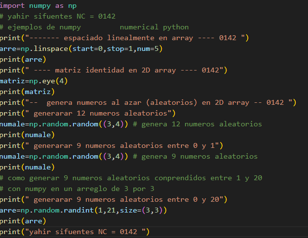
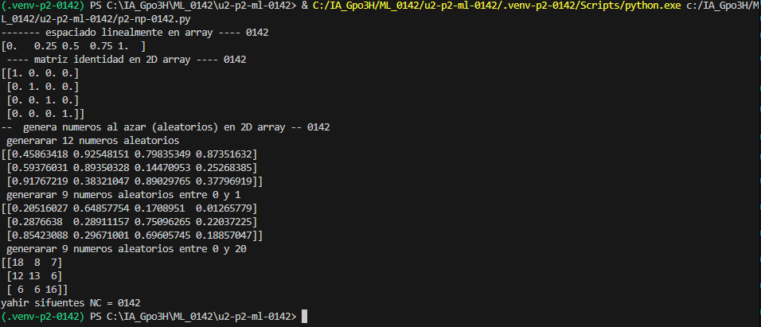

Unicamente la explicación de cada parámetro del código corregido (`np.linspace`):

* **`start=0`**: Define el **valor inicial** de la secuencia. En este caso, el intervalo comenzará en `0`.
* **`stop=1`**: Define el **valor final** de la secuencia. En este caso, el intervalo terminará en `1`.
* **`num=5`**: Define la **cantidad de elementos** que se generarán distribuidos de manera uniforme entre el valor inicial y el final (para este ejemplo generará 5 valores: `0.0`, `0.25`, `0.5`, `0.75` y `1.0`).

## que es np.linsoace
La función np.linspace() de NumPy genera un arreglo de números espaciados de manera uniforme (equidistantes) dentro de un intervalo determinado.

## el codigo 

## el resultado 
